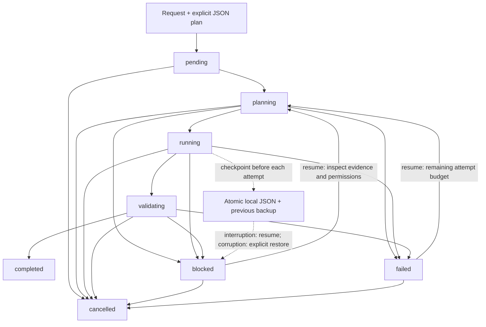

# Engineering OS — Modular Agent Skills

A modular engineering system with seven reusable Agent Skills and three specialized agent roles. Agents define bounded execution responsibility; skills supply reusable knowledge and procedures. Load only the agent and skills relevant to the task.

## Skills

| Skill | Use it for |
| --- | --- |
| `engineering-os` | Routing end-to-end or cross-disciplinary engineering work |
| `software-engineering` | Application, API, integration, architecture, debugging, and tests |
| `ai-engineering` | LLM applications, agents, retrieval, evaluations, and operations |
| `data-engineering` | Data quality, pipelines, SQL, metrics, analytics, and BI |
| `ui-ux-design` | Product flows, interfaces, accessibility, and design systems |
| `fde-delivery` | Field discovery, integration constraints, pilots, and handoff |
| `git-quality` | Git workflows, CI, review, security, and releases |

## Agents

Canonical, vendor-neutral role definitions live in `agents/`. They define responsibility, activation, boundaries, and completion criteria while referring to skills instead of repeating their procedures.

| Agent | Primary scope |
| --- | --- |
| `software-engineer` | Application and API behavior, implementation, reliability |
| `ai-engineer` | LLM applications, agents, retrieval, evaluation |
| `quality-reviewer` | Independent, read-only evidence-based review |

Data Engineering, UI/UX, and FDE remain available through their skills and do not have agent roles in this release. The `skills` metadata in each canonical agent definition is the only agent-to-skill mapping.

Adapter instructions live in `adapters/`. Generated files are disposable; edit only `agents/` and `skills/`.

## Install skills

Copy the skill directories into the directory your agent scans. Review any same-named skill before replacing it.

```powershell
# Codex, from this repository root
New-Item -ItemType Directory -Force "$HOME/.agents/skills" | Out-Null
Copy-Item -Recurse -Path "./skills/*" -Destination "$HOME/.agents/skills/"

# Claude Code, from this repository root
New-Item -ItemType Directory -Force "$HOME/.claude/skills" | Out-Null
Copy-Item -Recurse -Path "./skills/*" -Destination "$HOME/.claude/skills/"
```

For project-scoped installation, use `<project>/.agents/skills` for Codex or `<project>/.claude/skills` for Claude Code. Merge `templates/AGENTS.md` and `templates/CLAUDE.md` with existing project guidance; do not replace project instructions wholesale. Agent adapters must also be installed in each provider's native project location as documented below.

## Generate agent adapters

The generator writes native configuration and a copy of the seven skills into a staging directory. Review and merge the output into a target project; it never edits an agent's home directory or overwrites existing project configuration.

```powershell
python scripts/build_agent_adapters.py --target claude --output ./.generated-claude
python scripts/build_agent_adapters.py --target codex --output ./.generated-codex
```

Follow [Claude Code adapter instructions](adapters/claude/README.md) or [Codex adapter instructions](adapters/codex/README.md) to install. Claude Code loads project subagents from `.claude/agents/`; Codex CLI loads project custom agents from `.codex/agents/`. Claude's Quality Reviewer gets a read-only tool allowlist; Codex custom agents inherit their parent's sandbox, so the reviewer must run in a read-only parent session for enforcement. These mechanisms are not equivalent. No adapter performs merge, deploy, or publication actions.

## Validate

Structural validation uses Python 3.10 or later and only the standard library. Adapter loading tests use Python 3.11 or later to parse TOML with `tomllib`.

```bash
python scripts/validate_skills.py
python -m unittest discover -s tests -v
```

Provider smoke tests use the actual installed CLIs and isolated fixtures. Run `python scripts/run_agent_smoke_tests.py --provider codex` or `--provider claude`; provider absence/authentication failure is reported as unexecuted, never passed. Local transcripts and raw logs are written under `.local-evidence/` and must not be committed. See `tests/evidence/README.md` for evidence policy and limits.

The validator checks the seven expected skill directories, required frontmatter fields, names, descriptions, and local Markdown links. GitHub Actions runs it on pushes and pull requests.

## Design and attribution

The skills are original instructions informed by the practices described in the projects listed in [SOURCES.md](SOURCES.md). Their code and documents are not bundled here. Optional upstream tools remain separate dependencies and must be installed and reviewed independently.

This project is licensed under the MIT License; see [LICENSE](LICENSE). Third-party licenses apply to any upstream material incorporated in the future and must be preserved as required.

## Contributing

Keep skills focused, state their activation scope in `description`, and add or update validation examples when behavior changes. Use the smallest workflow appropriate to the task; update `CHANGELOG.md` for meaningful changes. Do not commit credentials or publish changes without review.

# Engineering Harness Lite v1

Historical v1 baseline below. For current Node gates and the optional Codex executor, see [Harness Lite v1.1](#engineering-harness-lite-v11).

## What it is

An optional local Python CLI for explicit plans, serial execution, acceptance checks, and conservative recovery. **Skills** remain the knowledge library, **agents** remain bounded specialist definitions, and **adapters** remain native provider configuration generators. The **Harness** tracks execution state around a small executor contract. It neither replaces provider sessions nor loads itself into agent prompts.

The v1 executes local file inspections and deterministic test fixtures, plus explicitly authorized project tests. It does **not** implement software from a natural-language request, call an LLM, or dispatch Codex/Claude subagents. A task is complete only relative to its configured gates; fixture success is synthetic evidence, never proof of real engineering work. Built-in execution makes no model calls and adds no token usage to ordinary skill use.

## How it works



`completed` and `cancelled` are terminal. `run` accepts only `pending`; `resume` handles unfinished work. The controller retains completed steps, reevaluates acceptance gates, and never resets attempt counters. The diagram shows legal transitions; cancelling an active CLI first requires stopping it with Ctrl+C, then using `cancel` after the workspace lock is released.

## Architecture

| Module | Input → output | Responsibility and limit |
| --- | --- | --- |
| `harness/orchestrator.py` | Task ID + permissions → persisted outcome | Serial lifecycle, checkpoints before attempts, terminal state only after gates |
| `harness/planner.py` | Explicit JSON plan → normalized steps/gates | Validate acceptance criteria, limits and ordered dependencies; no inferred AI planning |
| `harness/context.py` | Workspace/task ID → checked snapshot or focused context | Atomic JSON, backup, checksum, lock; context includes only dependencies, last five decisions and reference paths |
| `harness/router.py` | Selected skills/optional agent ID → canonical file paths | Reads existing agent-to-skill metadata; does not copy instruction bodies or dispatch agents |
| `harness/execution.py` | Step, context, workspace, attempt → structured evidence | `Executor.execute` contract; built-in local worker with timeout; fixture output explicitly labeled synthetic |
| `harness/recovery.py` | Incomplete state + one-time confirmations → retry decision | Classify interruptions and enforce lifetime attempts; uncertain non-idempotent work blocks |
| `harness/gates.py` | Acceptance gate + current evidence → passed/failed/blocked | File/hash checks, step completion, opt-in fixed test commands; unavailable review blocks |
| `harness/model.py` | State/transition → validated state or error | Schema version 1 and lifecycle invariants |
| `harness/__main__.py` | CLI arguments → JSON output/exit code | Local user interface, no server |

There are still exactly seven skills and three agents. Their files, adapters, scripts, and attribution remain unchanged by this Harness feature.

## Installation

Use Python **3.11 or newer** and a checkout of this repository. All modules use the standard library; no `pip install`, API key, provider CLI, or service is required. Run from the repository root:

```powershell
# Windows PowerShell
py -3 --version
py -3 -m harness --help
```

```bash
# Linux and macOS
python3 --version
python3 -m harness --help
```

Keep the current directory at the Harness repository when using `--workspace /path/to/project` before the subcommand. That option selects the inspected/tested workspace and its local state directory. Python module discovery still uses this checkout. Windows execution was verified; Linux/macOS paths are implemented with POSIX locking and process groups but have not been run locally in this delivery.

## Quick start

This complete task verifies that the repository README exists and can be read; it does not edit it:

```powershell
$task = py -3 -m harness create 'Inspect README locally' --plan examples/harness/inspect.json | ConvertFrom-Json
py -3 -m harness run $task.id
py -3 -m harness status $task.id
py -3 -m harness evidence $task.id
```

```bash
task_id=$(python3 -m harness create 'Inspect README locally' --plan examples/harness/inspect.json | python3 -c 'import json,sys; print(json.load(sys.stdin)["id"])')
python3 -m harness run "$task_id"
python3 -m harness status "$task_id"
python3 -m harness evidence "$task_id"
```

Expect `completed`, a `local-file` executor record, a SHA-256 digest, and a passed file gate. A worker process exiting successfully is not itself an acceptance result: the recorded `ok` and the gates must also pass.

Plans contain nonempty `steps` and `gates` arrays. See [inspection](examples/harness/inspect.json), [recovery](examples/harness/recovery.json), and [local validation](examples/harness/validate.json) examples. Schema rules are enforced by `planner.normalize`:

- Each step has `id` and `action`. Optional fields: `depends_on`, `skills`, `agent`, `idempotent` (default true), `max_attempts` (default 2, maximum 5), and `timeout_seconds` (default 10, maximum 300). Dependencies must name earlier steps; cycles and unknown fields are rejected. Maximum 32 steps and 32 gates.
- Actions: `file_exists` with a relative `path`; or test-only `fixture`, with optional `fail_until` (attempt number) and `delay_seconds`. No shell, arbitrary command, provider, merge, publish, or deployment action exists.
- Each gate has a unique `id`, a human-readable `criterion`, and `kind`. Supported kinds: `step_succeeded` with `step`; `file_exists` with `path`; `file_sha256` with `path` and lowercase `sha256`; `tests` with `suite` (`skills` or `unittest`); and `review`. Gates default to a 30-second timeout, maximum 300 seconds.
- Choose narrow skills explicitly. Optional `agent` enriches context with the canonical role's skill mapping; it does not execute that role. Simple tasks need one step and one meaningful gate.

## Execution, checkpoints and recovery

The CLI implements `create`, `status`, `run`, `resume`, `history`, `evidence`, `note`, `cancel`, and `restore`. All ID-taking commands use the ID returned by `create`. Exit codes: **0** command success, **1** invalid input/storage/lock error, **2** a run/resume stopped without completion. Use `status` to distinguish `failed` from `blocked`.

```powershell
# A synthetic non-idempotent operation fails its first attempt.
$recovery = py -3 -m harness create 'Exercise controlled recovery' --plan examples/harness/recovery.json | ConvertFrom-Json
py -3 -m harness run $recovery.id
# Expected: blocked, exit 2, one attempted operation.
py -3 -m harness resume $recovery.id
# Still blocked; the attempt count is unchanged.
py -3 -m harness resume $recovery.id --confirm-retry simulated-operation
# Expected: completed after attempt 2. Confirmation covers just one retry.
py -3 -m harness history $recovery.id
py -3 -m harness evidence $recovery.id
py -3 -m harness note $recovery.id 'Synthetic recovery inspected; no external effects'
```

Use `python3` with the same arguments on Linux/macOS. For actual interrupted work, inspect evidence and outstanding processes first. `resume` converts in-flight steps to interrupted outcomes; non-idempotent attempts require `--confirm-retry STEP`. Idempotent failed steps may retry automatically only within their persisted budget. Exhausted budgets require diagnosing the failure and creating an explicit new plan for the remaining work, rather than resetting counters.

State is stored at `<workspace>/.harness/<id>.json`, with schema version, revision, checksum, normalized plan, per-step attempts/results, gate evidence, decisions, and timestamped history. `.harness/` is ignored in this repository; an inner ignore-all `.gitignore` also protects state in other workspaces. Each save writes/fsyncs a temporary file and atomically replaces the checkpoint; the previous valid snapshot is retained as `<id>.bak`. POSIX also fsyncs the containing directory. Durability still depends on the filesystem; use a local filesystem, not a shared network state directory.

Malformed/schema-incompatible/checksum-invalid state stops execution. There is no silent fallback. `restore` refuses a valid primary checkpoint, validates the backup, preserves the damaged original as a unique `.corrupt` file, and blocks unfinished tasks for inspection. A terminal backup remains terminal:

```powershell
# Replace TASK_ID with the affected task's ID, after inspecting the failure.
py -3 -m harness restore TASK_ID
py -3 -m harness status TASK_ID
py -3 -m harness resume TASK_ID
```

A backup may predate the most recent start record. Restore conservatively charges a possible lost attempt to incomplete steps unless already recorded as in-flight. This can exhaust a budget; it prevents automatic replay of an operation whose result is unknown. Failed gates are rechecked on resume, while completed steps are preserved. An invalid backup is rejected too. Orphan temporary files are ignored, never treated as successful checkpoints.

## Quality gates and provider integrations

To execute the existing local validator and test suite through real gate processes:

```powershell
$validation = py -3 -m harness create 'Validate the local collection' --plan examples/harness/validate.json | ConvertFrom-Json
py -3 -m harness run $validation.id
# Blocks before test code is executed.
py -3 -m harness resume $validation.id --allow-tests
py -3 -m harness evidence $validation.id
```

The fixed commands are the current Python executable with `-B scripts/validate_skills.py` or `-B -m unittest discover -s tests -v`, resolved within the workspace. The CLI records exit code, timeout and duration, and discards raw output. Reproduce a failed command directly for diagnosis. Test execution permission applies only to that invocation; tests may have side effects and are **trusted project code, not sandboxed**.

Implemented: local file inspection/digests, deterministic fixture execution, local test gates, serial persistence and recovery. `Executor.execute(spec, context, workspace, attempt)` is the internal extension contract, with validated structured evidence; the CLI registers only the built-in executor. No external plugin discovery or generic command runner is exposed.

Codex and Claude Code continue to use the existing native adapters independently. Neither provider is wired into this Harness v1, and no operational Harness/provider compatibility is claimed. A `review` gate returns `blocked` with the existing Quality Reviewer definition and skill references, explicitly `agent_dispatched: false`; it cannot be satisfied by a simulated approval. Automatic reviewer dispatch is a future executor integration, not a shipped capability. T3 Code remains an optional interface with no Harness-specific dependency.

## Security and limits

- One mutating Harness operation holds the workspace's OS file lock at a time. Status reads use atomic snapshots. Different workspaces have independent locks; this is not a machine-wide scheduler.
- Built-in steps inspect only workspace-contained files, including resolved symlinks, up to 16 MB. State/Git/environment-file paths and path traversal are rejected. They never edit source files.
- Test commands require `--allow-tests`. No permissions are granted to providers. No automated merge, deploy, publication, destructive Git operation, or external effect is implemented.
- Non-idempotent retries need a one-use confirmation. Timeouts terminate the owned process group/tree where supported. After an uncatchable parent termination or machine failure, inspect remaining processes before resuming; detached test children and arbitrary test behavior are outside this CLI's sandbox guarantees.
- Checkpoints contain no environment dumps, credentials fetched from providers, file contents, raw command output, or transcripts. Keep credentials out of requests, criteria and notes too: common secret patterns are rejected, but arbitrary secrets cannot be reliably detected. Checksums detect corruption; they do not authenticate locally modified state.
- Attempts and per-call timeouts are bounded; there is no infinite retry loop. No global task deadline is implemented. State files are limited to 4 MB. Completed/cancelled tasks are retained for inspection; retention cleanup is manual.

## Tests and verified results

```powershell
py -3 scripts/validate_skills.py
py -3 -m unittest discover -s tests -v
```

On Linux/macOS, replace `py -3` with `python3`. The suite covers state creation, every lifecycle edge, actual fixture processes, retries/timeouts, interruption, corrupt checkpoints, atomic-write failure, one-use confirmations, preservation of completed steps, process locking, file and test gates, CLI commands, canonical routing and existing adapters. See [Harness v1 evidence](tests/evidence/harness-lite-v1.md) for the verified Windows run and controlled recovery demonstration. Provider smoke tests were not run for this feature; existing adapter loading tests remain structural compatibility checks.

## v1 limitations and roadmap

Shipped: the local CLI, explicit plans, bounded serial executors, JSON checkpoints, recovery and gates described above. There is no server, dashboard, distributed queue, database, parallel execution, autonomous code-generation planner, provider session management, or production side-effect executor.

Possible future work, requiring separate design and evidence: a documented native provider executor with permission/cost controls; real Quality Reviewer dispatch; provider event evidence; stronger process supervision; cross-platform CI coverage and schema migrations. These are not implemented or required to use v1.

# Engineering Harness Lite v1.1

An additive evolution of v1: controlled Node quality gates and an optional **real, read-only Codex CLI executor**. The seven skills, three agents and native adapters remain unchanged. No new service, dependency package or automatic delegation is introduced. Local execution remains the default.

## Architecture and compatibility

The existing planner, state machine, JSON schema v1, atomic storage, workspace lock and canonical router are reused. Old plans remain readable without migration. New capabilities live in `node_gates.py`, `processes.py` and `codex.py`.

| Component | Input → output | Boundary |
| --- | --- | --- |
| Node gates | Approved profile, relative cwd, structured args → exit code, duration, timeout, result | Installed local entrypoints only; no shell, npm scripts, npx or installation |
| Process supervisor | argv, deadline → bounded process outcome | Windows Job Object; POSIX process group; uncertain termination blocks replay |
| Codex executor | Explicit prompt and selected context → native session/turn metadata | Read-only, ephemeral, approval policy `never`, opt-in cost; no automatic retry |
| Existing orchestrator/storage | Plan → checkpoints before/after execution and at session start | Serial per workspace; independent quality gates still required |

| Capability | v1 | v1.1 | Evidence |
| --- | --- | --- | --- |
| Python unittest / skill validator | Supported | Preserved | Real subprocess tests |
| Node built-in tests | Unavailable | `node-test` | Real Node 22 execution, failure and recovery |
| Vitest, Playwright, ESLint, TypeScript | Unavailable | Local package profiles | Entry resolution/argv unit tests; frameworks not smoke-tested here |
| Vite / Next build | Unavailable | `build` / `next-build` | Entry resolution/argv unit tests |
| Codex CLI | No executor | Optional real read-only execution | One Windows smoke passed on 0.159.0 |
| Claude Code | Native adapters only | Unchanged; no Harness executor | Adapter loading tests; no new real Claude run |
| T3 Code | Optional interface | Optional interface | No native Harness/T3 integration |

## Installation and quick start

Requirements: Python 3.11+, checkout of this repository; Node only for Node gates; separately installed and authenticated Codex only for Codex steps. No `pip install` is needed. Run the module from the repository root; `--workspace` selects the target, not Python's import directory.

Windows PowerShell, a complete local Node task:

```powershell
py -3 --version
node --version
$task = py -3 -m harness create "Validate Node fixture" --plan examples/harness/node-test.json | ConvertFrom-Json
py -3 -m harness run $task.id --allow-tests --test-profile node-test
py -3 -m harness evidence $task.id
```

Linux/macOS:

```bash
python3 --version
node --version
task_id=$(python3 -m harness create "Validate Node fixture" --plan examples/harness/node-test.json | python3 -c 'import json,sys; print(json.load(sys.stdin)["id"])')
python3 -m harness run "$task_id" --allow-tests --test-profile node-test
python3 -m harness evidence "$task_id"
```

These commands exercise the committed `node:test` fixture without downloading packages. Windows was executed locally; Linux/macOS CI is configured, with results pending until the branch is published.

## JSON plans and Node profiles

Existing inspection plans still work:

```json
{
  "steps": [{"id": "inspect", "action": {"kind": "file_exists", "path": "package.json"}}],
  "gates": [{"id": "present", "kind": "file_exists", "path": "package.json", "criterion": "Manifest exists"}]
}
```

A Node project validation plan:

```json
{
  "steps": [{"id": "inspect", "action": {"kind": "file_exists", "path": "package.json"}}],
  "gates": [
    {"id": "unit", "kind": "node", "profile": "vitest", "cwd": ".", "args": ["--reporter=dot"], "timeout_seconds": 120, "criterion": "Unit tests pass"},
    {"id": "types", "kind": "node", "profile": "typecheck", "timeout_seconds": 60, "criterion": "TypeScript checks pass"}
  ]
}
```

Review [the complete Node project example](examples/harness/node-project.json), remove irrelevant gates, then use `--workspace /absolute/project` before `create`, `run` and `resume`. Dependencies, Playwright browsers and project configuration must already be installed and trusted. No framework versions are prescribed by the Harness.

| Profile | Local package / entrypoint arguments |
| --- | --- |
| `vitest` | `vitest` → `run` |
| `playwright` | `@playwright/test` → `test` |
| `eslint` | `eslint` → supplied paths, default `.` |
| `typecheck` | `typescript` / `tsc` → `--noEmit` |
| `build` | `vite` → `build` |
| `next-build` | `next` → `build` |
| `node-test` | Node → `--test` plus explicit existing file paths |

`cwd` defaults to `.` and must stay inside the workspace, including after resolving symlinks. Paths cannot access `.git`, `.harness` or `.env*`. `args` is an array, never shell text. Allowed options: Vitest `--coverage`, `--reporter=dot`, `--reporter=verbose`; Playwright `--workers=1`, `--reporter=line`, `--reporter=list`; ESLint `--max-warnings=0`. Other flags are rejected, including watch/help and Vitest's empty-suite success flag. Select TypeScript/Vite/Next projects with `cwd`; arbitrary command profiles are not supported.

`--allow-tests` authorizes trusted test code for that invocation. Repeat `--test-profile` to narrow allowed Node profiles; omitting it allows any declared built-in profile. Missing Node/tool/test files and missing authorization are reported separately as blocked reasons. Nonzero exit or timeout fails the gate. Unknown termination blocks it. No stdout/stderr is persisted.

## Real Codex execution

The implemented interface is [Codex CLI non-interactive JSONL](https://learn.chatgpt.com/docs/non-interactive-mode), verified against installed `exec --help` and CLI 0.159.0. It uses `--json --ephemeral --ignore-user-config --sandbox read-only`, stdin prompt, fixed working directory, disabled web search/multi-agent and `approval_policy="never"`. No unrestricted or bypass option exists in the Harness CLI.

Create a separate synthetic folder with a non-sensitive `sample.txt`. Use [codex-inspect.json](examples/harness/codex-inspect.json), from the Harness checkout:

```powershell
$workspace = Join-Path $env:TEMP ("harness-demo-" + [guid]::NewGuid().ToString("N"))
New-Item -ItemType Directory $workspace | Out-Null
Set-Content -LiteralPath (Join-Path $workspace "sample.txt") -Value "Synthetic arithmetic: 6 * 7 = 42."
$task = py -3 -m harness --workspace $workspace create "Read fixture" --plan examples/harness/codex-inspect.json | ConvertFrom-Json
# Execute only after authorizing provider quota/cost:
py -3 -m harness --workspace $workspace run $task.id --allow-codex
py -3 -m harness --workspace $workspace evidence $task.id
```

```bash
workspace=$(mktemp -d)
printf 'Synthetic arithmetic: 6 * 7 = 42.\n' > "$workspace/sample.txt"
task_id=$(python3 -m harness --workspace "$workspace" create "Read fixture" --plan examples/harness/codex-inspect.json | python3 -c 'import json,sys; print(json.load(sys.stdin)["id"])')
# Execute only after authorizing provider quota/cost:
python3 -m harness --workspace "$workspace" run "$task_id" --allow-codex
python3 -m harness --workspace "$workspace" evidence "$task_id"
```

If discovery fails, pass `--codex-bin` with the trusted native executable or installed `@openai/codex/bin/codex.js`. Shell wrappers (`.cmd`, `.bat`, `.ps1`) are rejected. JS entrypoints require Node. Discovery also supports `CODEX_MANAGED_PACKAGE_ROOT`. Preflight checks version/help without model calls; absence or unsupported flags blocks before consuming an execution attempt.

Authentication remains in the installed `CODEX_HOME`; the Harness never copies it. User provider/model/MCP/hook configuration is intentionally not loaded. On Windows, only the existing recognized `windows.sandbox` choice is retained; organization policies and execpolicy rules remain authoritative. Project `.codex/config.toml` in the workspace or ancestors is rejected to avoid silently enabling MCP/hooks: use an isolated workspace. This restriction does not modify the existing agent adapters. Custom provider endpoints and arbitrary CLI overrides are outside v1.1.

The reproducible real smoke runner is `py -3 scripts/smoke_harness_codex.py --allow-codex` (or `python3`); it creates an isolated temporary fixture, uses 120 seconds and one attempt, checks its SHA-256, and writes safe metadata under ignored `.local-evidence/harness-v1.1/`. **Every invocation can incur provider usage; it is not part of automated tests.**

## Checkpoints, recovery and permissions

Checkpoints retain schema v1 in ignored `.harness/`. Before a Codex call, the attempt is durably recorded; a native `thread.started` adds the session ID while running. Completion requires exit zero, `turn.completed`, no provider error, complete event capture and confirmed process termination. Quality gates run afterward; model/process success alone never satisfies unrelated criteria.

Codex steps are always non-idempotent for replay purposes, default to one attempt and cannot request automatic retries. Timeout, missing terminal event, capture failure or uncertain process termination blocks the task. Other provider failures fail it. `resume` retains completed steps. If budget remains, replay requires **both** renewed `--allow-codex` and `--confirm-retry STEP`, after inspecting the previous outcome and ensuring processes stopped. Exhausted budgets are never reset. Ephemeral session IDs are correlation evidence, not resumable native conversations.

Interrupted tests or uncertain termination require `resume --allow-tests --confirm-gate GATE`; restoration from a corrupt checkpoint also conservatively marks executable gates uncertain. Confirmations are human attestations, not proof that a remote process stopped. Example for a previously interrupted gate named `unit`:

```text
python -m harness --workspace /absolute/project resume TASK_ID --allow-tests --confirm-gate unit
```

The configured execution timeout excludes preflight and a short bounded cleanup period. Windows uses a kill-on-close Job Object established before the worker starts. POSIX uses process groups; deliberately detached descendants and remote effects are not fully containable. Unknown outcomes require inspection. Test code is **trusted and not sandboxed**: it may write artifacts or access services, so review tests and their configuration before `--allow-tests`. Provider read-only permissions apply to Codex shell tools, not to test gates.

No merge, push, deploy, publication or destructive-operation command is provided. Plans cannot provide arbitrary executables or shell strings. The Harness is not a hostile-code security boundary; sandbox enforcement depends on the provider and OS. Requests/plans/decisions must contain no secrets; common credential patterns are rejected but this is not comprehensive secret detection. Raw model messages, command output and transcripts are discarded. Provider-side telemetry/auth storage is governed by the provider itself.

## T3 Code and remaining limits

T3 documents an official [MCP interface for outside agents](https://github.com/pingdotgg/t3code/blob/main/docs/user/outside-agents.md). v1.1 deliberately uses the independent Codex CLI interface; it does not connect to T3 MCP, private APIs or databases.

- **Harness → Codex:** this implementation owns the attempt, process supervision and checkpoints.
- **T3 → Codex:** T3 owns that session; Harness checkpoints do not supervise it.
- **Codex → manual Harness command:** Harness owns only the invoked local task, not its parent conversation.

No Claude executor, native reviewer dispatch, workspace-write Codex mode, dashboard, server, distributed queues, parallel execution or arbitrary npm scripts are shipped. Canonical skills/agent references are supplied progressively as paths; that is not evidence of native subagent activation. The `review` gate remains explicitly blocked until a real reviewer integration exists. Framework smoke tests and Linux/macOS execution remain to be verified; the CI matrix is configured, not yet run for this branch.

## Tests, evidence and next steps

```powershell
py -3 scripts/validate_skills.py
py -3 -m unittest discover -s tests -v
git diff --check
```

Use `python3` on Linux/macOS. All original 38 tests are retained. New tests exercise real Node success/failure/recovery and process timeout, profile restrictions, Codex JSONL unit fixtures, authorization, durable starts, session checkpoints, unknown outcomes, exhausted budgets and preservation of completed work. Unit Codex fixtures never consume provider quota.

See [v1.1 evidence and audit](tests/evidence/harness-lite-v1-1.md) for exact results, measured provider usage and scope. Future work: execute actual framework suites on representative projects, confirm the CI matrix, evaluate isolated write permissions and native reviewer integration. These require their own safety criteria and evidence.
